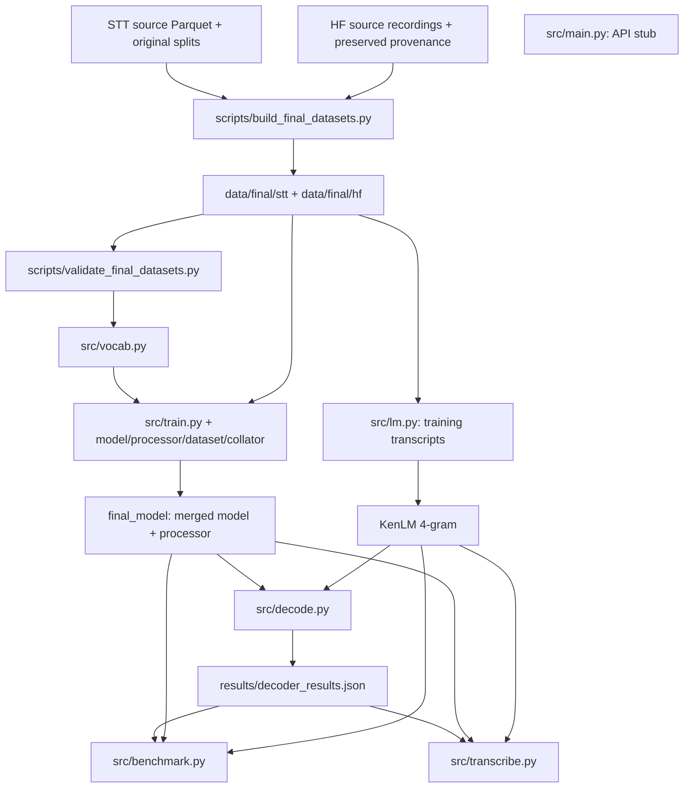
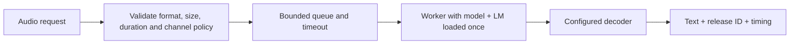

# Project architecture and release flow

This is a proposed organization, based on the 2026-10-22 review. Python files, imports and artifact paths have not been moved or changed. The current executable entry points are still under `src/`.

## Current implementation



The diagram describes dependencies. The missing configuration setting currently blocks training and batch evaluation; the advertised server model and decoder assets are absent locally. The API stub has no connection to inference.

The current design already has useful boundaries: dataset construction, dataset validation, acoustic model training, LM construction, decoder tuning, evaluation and single-file transcription. Keep those responsibilities while making run and release identity explicit.

## Proposed logical boundaries

| Area | Owns | Inputs | Outputs |
| --- | --- | --- | --- |
| Data preparation | Import, source identity, audio conversion, text normalization, split assignment | Immutable upstream snapshots | Versioned train/validation/test data and provenance |
| Training | Tokenizer, model initialization, LoRA, optimization, checkpoints | Dataset revision and explicit training configuration | One immutable run with resumable state and selected export |
| Evaluation | Metrics, output-length trimming, LM tuning, benchmark normalization | Run export, fixed data revisions | Predictions, decoder settings, metrics, exclusions and report |
| Release | Artifact inventory, hashes, licenses, model/dataset cards | Verified evaluation and complete provenance | A downloadable, versioned model bundle and dataset releases |
| Inference | Load a released bundle; normalize incoming audio; decode | Pinned release and audio | Transcription and release identity |
| Service/demo | Interface, resource limits, request queue, errors and operational metrics | Inference engine | Public UI or API |

Inference should consume a completed release. Users should not need training data, test references, checkpoint discovery or a validation-tuning job just to transcribe audio.

## Proposed repository layout

The layout below is a future target. Moving Python modules would require import and packaging work and has not been done under the current no-code-change constraint.

```text
karakalpak-stt-model/
  README.md                    entry point: release status, results, downloads, quick start
  LICENSE                      selected code license
  CITATION.cff                 authors and versioned citation
  pyproject.toml + uv.lock      complete supported dependency environment
  src/karakalpak_asr/
    data/                      loading, audio contracts, normalization, collator
    modeling/                  tokenizer/processor, acoustic model, LoRA
    training/                  training loop, explicit resume, checkpoint export
    decoding/                  greedy, beam, KenLM and release decoder configuration
    evaluation/                metrics, benchmarks, result writers
    inference/                 load bundle and transcribe
    serving/                   API startup, schemas and endpoints
  scripts/
    data/                      source import/build/validation entry points
    release/                   export/inventory/publication entry points
  configs/
    training/                  immutable experiment presets
    serving/                   supported runtime limits and release selection
  docs/
    release_readiness.md
    project_architecture.md
    publication_guide.md
    pipeline/                  historical PDF walkthrough and map
  reports/<run-id>/            small tracked results, provenance, plots, selected logs
  experiments/legacy/          clearly labelled older exercises and architecture prototypes
  third_party/kenlm/           pinned upstream dependency
  data/                       local source and prepared data; ignored
  outputs/runs/<run-id>/       local training state; ignored
  outputs/releases/<version>/  local assembled release; ignored
```

Keep one GitHub repository for the active project initially. Distinct Hugging Face model and dataset repositories provide the public artifact boundaries. More code repositories or services would add maintenance without resolving the current release blockers.

### Current files mapped to the proposed areas

| Current paths | Proposed responsibility |
| --- | --- |
| `scripts/build_final_datasets.py`, `validate_final_datasets.py`, source recovery/organization tools | Data preparation entry points, with legacy tools labelled separately |
| `src/dataset.py`, `collator.py` | Data loading and batching |
| `src/vocab.py`, `processor.py`, `model.py` | Acoustic model construction and tokenization |
| `src/train.py` | Training and export |
| `src/lm.py`, decoder helpers in `src/decode.py` | LM building and decoding |
| `src/metrics.py`, `evaluate_model.py`, `benchmark.py`, benchmark-preparation script | Evaluation |
| `src/transcribe.py` | Inference entry point |
| `src/main.py` | Future API adapter |
| Root empty entry points, `configs/conformer_rnnt.py`, `src/ai_ml/`, CTC exercise | Legacy/incomplete experiments, outside the supported runtime |
| Root `kaa.arpa`, `lm_text.txt`, `vocab.json` | Legacy artifacts with distinct provenance; preserve until deliberately archived |

## Recommended release flow

```mermaid
flowchart LR
    SOURCE[Identify sources and rights] --> DATA[Freeze dataset version]
    DATA --> VALIDATE[Validate audio, text and splits]
    VALIDATE --> RUN[Train explicit run ID]
    RUN --> TUNE[Select model and tune LM on validation]
    TUNE --> TEST[Evaluate fixed test sets]
    TEST --> BUNDLE[Export complete release + hashes]
    BUNDLE --> RELOAD[Reload from clean environment]
    RELOAD --> PUBLISH[Publish linked research artifacts]
    PUBLISH --> DEMO[Public demonstration]
    DEMO --> QUALIFY[Measure intended product behavior and capacity]
    QUALIFY --> PROD[Production service]
```



Any data or hyperparameter change creates a new run. Resuming continues one explicitly selected run. Test results describe a frozen candidate; changes made after inspecting them need fresh evaluation and transparent versioning.

### Run record

Each run should retain the exact source commit, dirty-tree status, base-model revision, dataset revisions and split hashes, configuration, vocabulary hash, dependency versions/lock, hardware, seeds, training history, checkpoint-selection rule and resulting artifact hashes. This lets a reader connect a reported result to the code and data that produced it.

Resumable state belongs with its run. A deployable release contains the merged inference model and all decoder assets needed for its documented mode. An optional adapter release must also include the trained CTC head, matching tokenizer, adapter configuration and pinned base revision.

### Proposed serving flow



Choose worker count, batching, maximum duration and hardware from measurements. The advertised scores use beam width 100 with KenLM; a greedy deployment is a different decoding mode with different reported quality. Longer recordings need an explicit chunking/overlap policy and corresponding evaluation.

A readiness check should report ready only after the pinned model and decoder load. Operational evidence should include latency percentiles, real-time factor, peak memory, concurrent-request behavior, failure handling and representative noisy/unseen-speaker audio. These requirements describe future implementation, not functionality added by this review.
